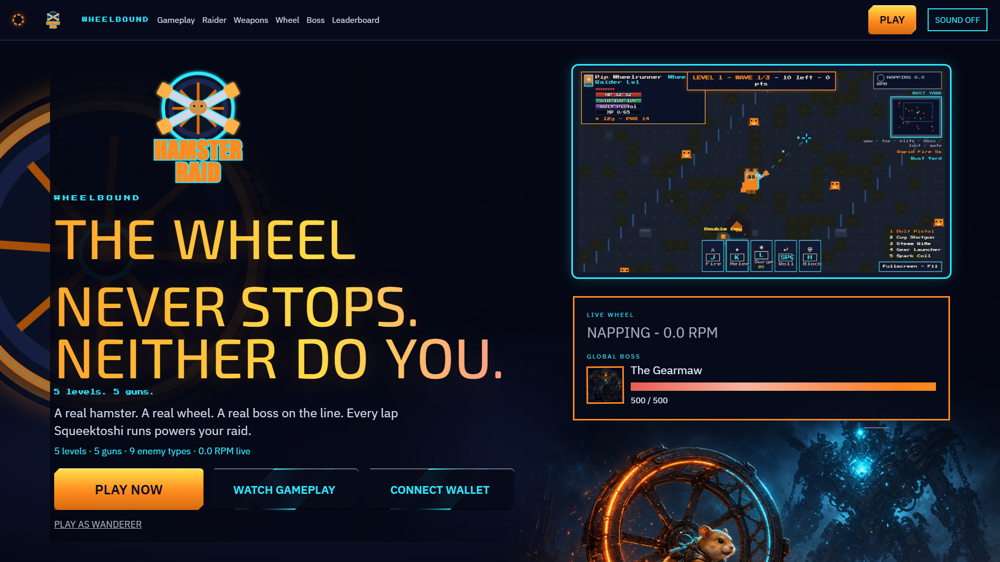
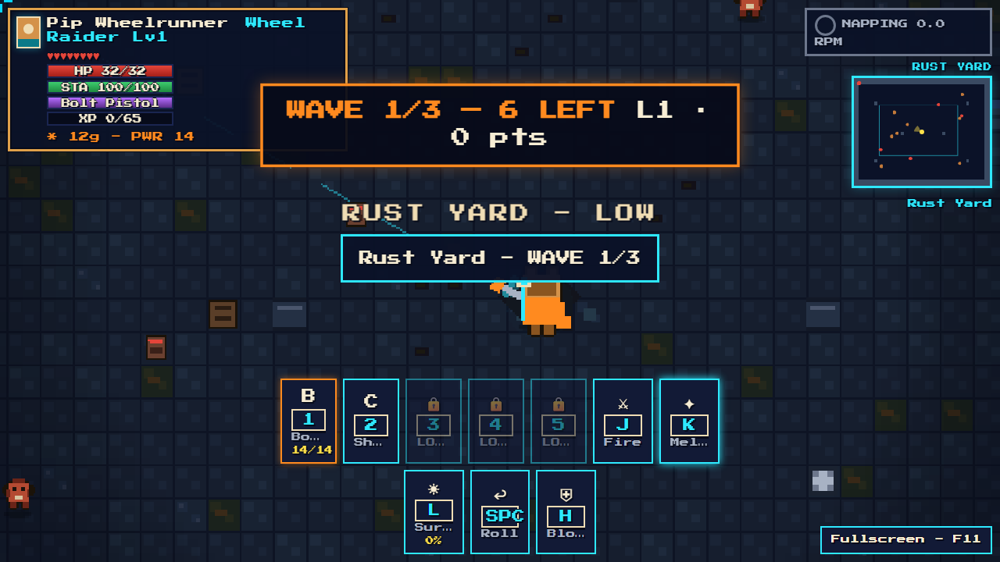

# Hamster Raid: Wheelbound

A 2D top-down action RPG in the browser, powered by a **real hamster wheel**.

Squeektoshi runs on [Squeekchain](https://squeekchain.com). When he runs, Wheelhaven’s gears turn, doors open, and your Wheel Charge fills. When he naps, the foundry goes dim and the Gearmaw drinks the quiet. This is a game, not a dashboard: personal combat is real-time; Wheel Surge also ticks a weekly **global** boss bar from settled wheel work.

Wallet is optional. Connect on Sepolia for a **free signature only** (never a transaction), or play as a Wanderer with no wallet.





## Squeekchain

```html
<meta name="squeekchain-verification" content="hamster-raid" />
```

Live data is polled every 12s from `https://api.squeekchain.com/v1/status` and `/v1/economy/state`. Last good snapshot is kept. Failures show **STALE**. No fake HP.

| Live field | In-game |
| --- | --- |
| `measurement.coreStatus` IDLE / ACTIVE | Nap: tint, foundry gate locks, enemies slower, Gearmaw heals. Run: gears spin at live RPM, Wheel Charge fills. |
| `rpmMilli` | Gear rotation. HUD wheel chip (top-right). |
| `cumulativeWorkUnits` + settled round `work` | Weekly global boss HP. Round events write the lore codex. |
| `builder.anchor.settledThroughRound` / economy `currentRound` | Shrine plaque, HUD round index, last-hit from `keccak256(dataHash ‖ roundId)`. |

## Play Pip Wheelrunner

One hamster, five guns. Training Arena (skip with Tab / N / F9) then Battlefield levels 1–5: Rust Yard, Cog Flats, Oilworks, Steam Pit, The Gearmaw.

### Controls

| Input | Action |
| --- | --- |
| WASD | Move |
| Mouse | Aim (gun follows the cursor) |
| Click / J | Fire |
| K | Melee |
| Space | Roll |
| H | Block |
| L | Wheel Surge |
| 1–5 / Q E | Swap guns |
| R | Reload |
| I | Pack |
| Esc | Pause |
| F3 | FPS meter |
| F9 / Tab / N | Skip training |
| F11 | Fullscreen |

QA flags: `?qa=1` town, `?qa=arena` academy, `?qa=battle` level 1, `?qa=perf` 80-enemy stress.

## Tech stack

- **Shell:** Vite + React + Zustand (landing, wallet, HUD)
- **Game:** Phaser 3.80 Arcade WEBGL, internal height 270, variable width
- **Wallet:** wagmi + viem, WalletConnect / MetaMask / injected, Sepolia
- **API:** Vercel functions in `api/` (nonce, join, save, surge, cron). Optional Vercel KV.

## Run locally

```bash
npm install
cp .env.example .env   # then set VITE_WALLETCONNECT_PROJECT_ID
npm run dev            # http://127.0.0.1:5173
```

```bash
npx tsc --noEmit
npm test
npx playwright test --config=playwright.config.ts
npm run build          # output: dist/
```

## Environment variables

Copy `.env.example`. Nothing secret belongs in the repo.

| Variable | Where | Purpose |
| --- | --- | --- |
| `VITE_WALLETCONNECT_PROJECT_ID` | Vite (client) | WalletConnect Cloud project id |
| `VITE_SITE_URL` | Vite (client) | Public URL for OG / share cards |
| `KV_REST_API_URL` | Vercel | Vercel KV. Local fallback: `.data/store.json` |
| `KV_REST_API_TOKEN` | Vercel | Vercel KV token |
| `CRON_SECRET` | Vercel | Auth for `/api/cron` |
| `SEPOLIA_RPC_URL` | Vercel | Read-only Sepolia RPC (default `https://rpc.sepolia.org`) |
| `LLM_API_KEY` | Vercel | Optional narrator. Empty → template copy |
| `LLM_API_URL` | Vercel | Optional LLM endpoint |
| `LLM_MODEL` | Vercel | Optional model name |

Build: `npm run build`. Output: `dist/`. `vercel.json` rewrites unknown paths to `index.html` so deep links work. Do not commit `.env`.

## Art

Town tiles: [Kenney Tiny Town](https://kenney.nl/assets/tiny-town) (CC0). Heroes, enemies, arena tiles, and SFX are a runtime pixel atlas (`src/game/pixels.ts`, `src/game/sfx.ts`). Fonts: Press Start 2P, Silkscreen (SIL OFL).

## License

MIT. See [LICENSE](LICENSE).
